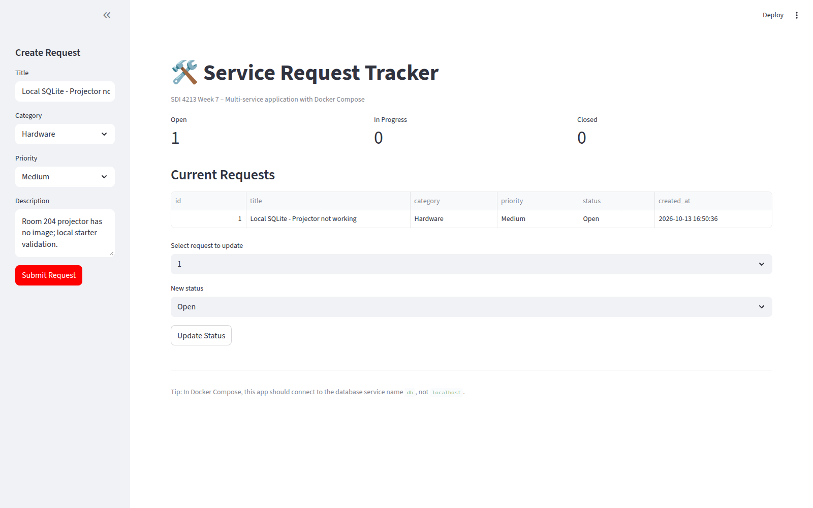
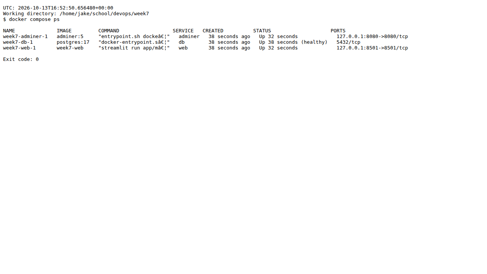
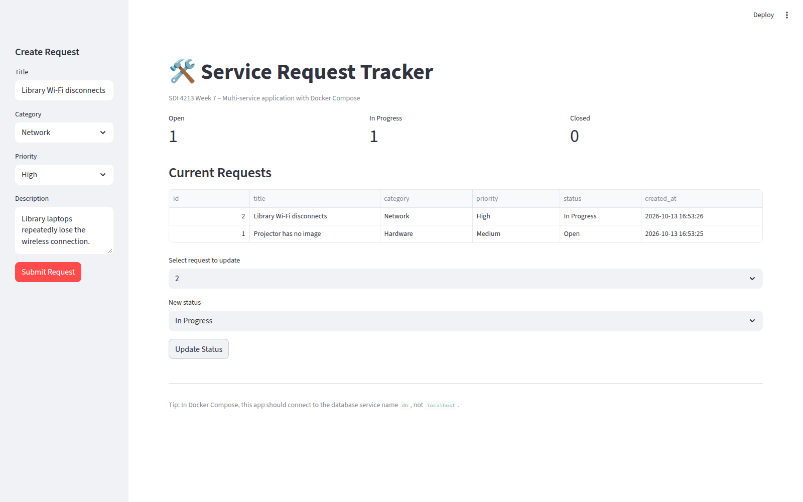
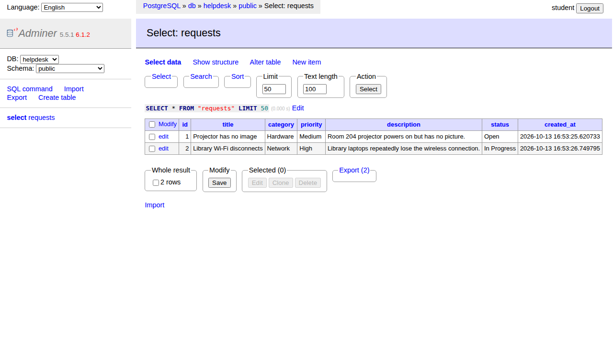
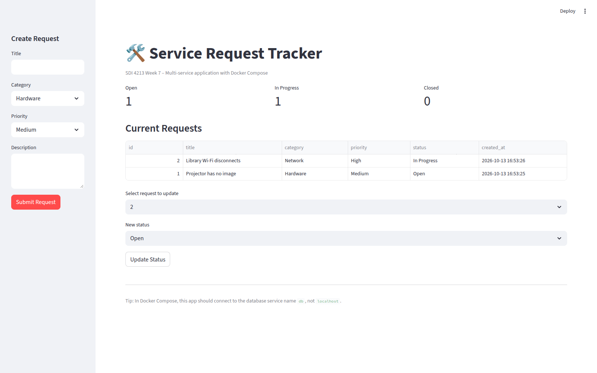
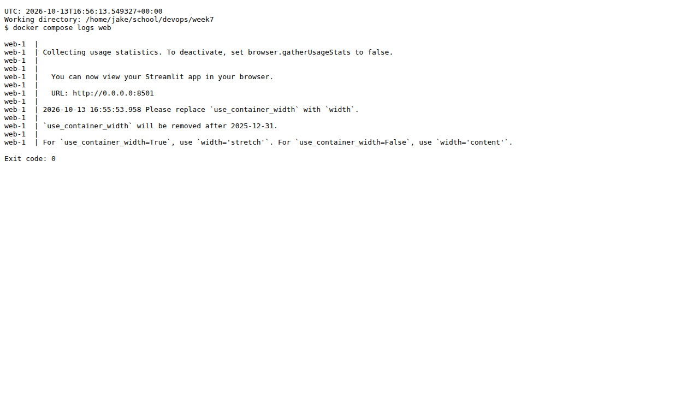
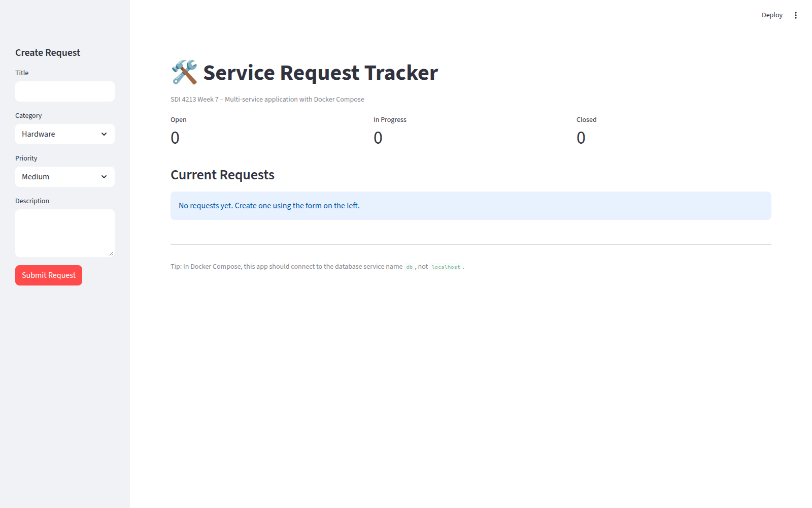
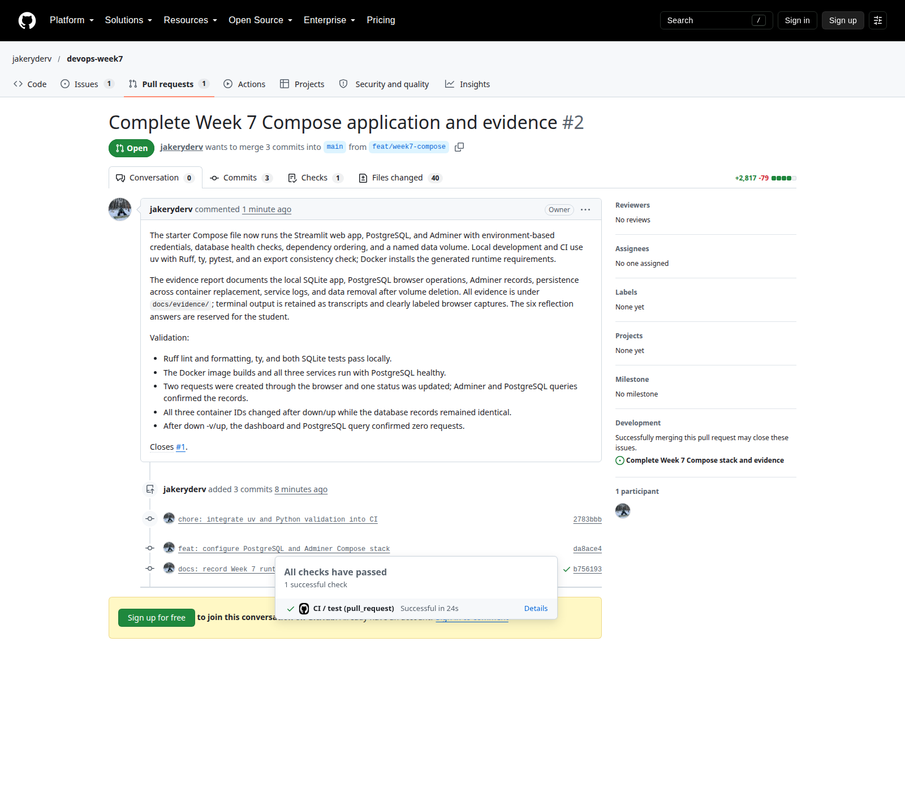

# Week 7 Evidence

Student Name: Jake Van Slyke

Repository URL: https://github.com/jakeryderv/devops-week7

Pull Request URL: https://github.com/jakeryderv/devops-week7/pull/2

## Screenshot 1 – Local app running

The local Streamlit application ran in the uv-managed Python 3.13 environment using SQLite. The visible request demonstrates that the starter application can create and list a service request.

## Screenshot 2 – Docker Compose services running

The `docker compose ps` output shows `web`, `db`, and `adminer` running, with PostgreSQL marked healthy.

## Screenshot 3 – Browser dashboard with at least two requests

The dashboard shows two distinct requests created through the Compose application. Request 2 was updated to "In Progress", and the table and status counts show one Open request and one In Progress request.

## Screenshot 4 – Adminer connected to PostgreSQL

Adminer connected to PostgreSQL using server `db` and database `helpdesk`. The `requests` table shows the same two requests and updated status as the dashboard.

## Screenshot 5 – Data persists after docker compose down / up

After `docker compose down` and `docker compose up -d`, the same requests remained with their original IDs, statuses, and creation timestamps. The named volume preserved the PostgreSQL data during container replacement.

## Screenshot 6 – Web service logs

The `docker compose logs web` output shows Streamlit starting and listening on port 8501.

## Screenshot 7 – Effect of deleting the database volume

After `docker compose down -v` and `docker compose up -d`, the restarted dashboard contained no requests and all status counts were zero. Deleting the named volume removed the previously stored PostgreSQL data.

## Screenshot 8 – Final GitHub pull request with passing CI

Pull request #2 shows the repository and the `feat/week7-compose` branch targeting `main`. The visible "All checks have passed" message confirms that the CI check succeeded.

## Reflection

> 1. Why must the web service use `db` rather than `localhost` to reach PostgreSQL?

Docker has its own internal networking and environment. Inside the web container, `localhost` refers to the web container itself. Docker Compose allows services to communicate using their service names, such as `db`, through its internal network. The web service therefore uses `db` to reach the PostgreSQL container.

> 2. What problem does the named Docker volume solve?

A named Docker volume provides persistent storage for PostgreSQL, allowing its data to survive when containers are removed or recreated. Stopping a container alone does not delete its data.

> 3. What is the difference between `docker compose down` and `docker compose down -v`?

`docker compose down` removes containers and networks but preserves named volumes and their data.

`docker compose down -v` also removes the named volumes, deleting the stored database data.

> 4. What role does the database health check play?

The health check is to verify that PostgreSQL is ready to accept connections. It allows dependent services to wait until the database is healthy and make sure that it is accessible for the functionality that they are dependent upon.

> 5. How is Docker Compose similar to Infrastructure as Code?

Docker is the underlying containerization technology, while Docker Compose is built on top to manage multi-container applications. It defines services, networking, storage, and configuration declaratively rather than through manual setup, which makes things more reproducible, consistent, and easier to maintain.

> 6. What was the most difficult problem you encountered and how did you solve it?

Everything was pretty straight forward and didn't encounter any real difficult problems, but the first thing I thought of was the docker networking type of things. I have some brief previous networking experience, but not much docker experience. So it wasn't as intuitive to me to utilize and distinguish the traditional vs docker type of networking things. My "solve" was more just learning about and seeing how docker has its own internal networking and management. It made implementing and using the named services like `db` much more intuitive and straightforward to accomplish everything.
